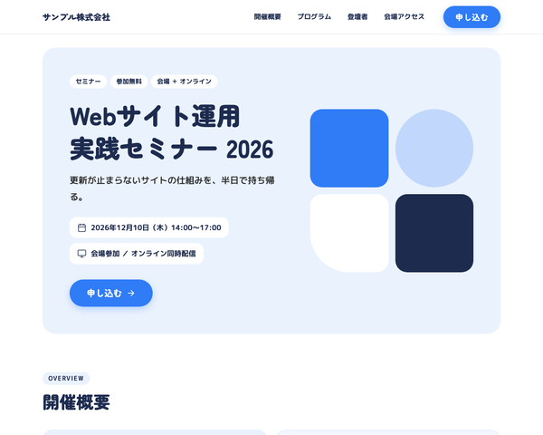

# BcLpEventTheme

baserCMS5用の、イベント・セミナーの告知と申し込みのための1ページ LP（ランディングページ）テーマです。
開催概要・プログラム・登壇者・会場アクセス・よくある質問・申し込みフォームまでを、
BurgerEditor のブロック操作と管理画面の設定だけで編集できます。

## 主な機能

- **1ページ LP**：トップの固定ページ1枚に、セクションを BurgerEditor のブロックで並べる構成
  - ヒーロー／開催概要（タイル）／こんな方におすすめ／プログラム／登壇者／会場アクセス（地図）／よくある質問／申し込み（CTA）
  - セクションの追加・削除・並べ替えは、ブロック操作だけでできる
- **ページ内ナビの自動生成**：大見出しブロックの「ID設定」に英字（例 `program`）を入れると、ヘッダーのナビに載る。
  見出しの上には ID から作った英字のラベル（`PROGRAM`）が出る
- **申し込みフォーム**：入力 → 確認 → 完了の3画面。項目は管理画面のメールフィールドで追加・並べ替えできる
- **テーマ設定の4色**で全体の配色が変わる（メイン／サブ／リンク／ホバー）。ロゴもテーマ設定で変更できる
- **初期データ**：見本サイト一式（`default`）と、最小構成（`empty`）
- レスポンシブ（PC／スマホ）、`prefers-reduced-motion` 対応

## 動作環境

- baserCMS 5.4以上
- BurgerEditor（BcBurgerEditor）プラグインが有効であること

## インストール

1. `plugins/BcLpEventTheme` に配置
2. 管理画面 > プラグイン管理 で BcBurgerEditor が有効になっていることを確認
3. 管理画面 > テーマ管理 で BcLpEventTheme を適用
4. 同じ画面で初期データ `default`（見本サイト）または `empty`（最小構成）を読み込む

> 初期データを読み込むと、ユーザー以外のデータ（固定ページ・メールフォーム・サイト基本設定など）は初期化されます。
> 運用中のサイトでは読み込まないでください。

## 使い方

### 編集できる場所

| 内容 | 編集する場所 |
|---|---|
| 本文（全セクション） | 固定ページ「トップページ」の BurgerEditor |
| ロゴ・配色 | テーマ設定 |
| ヘッダーのナビ | 本文の大見出しブロックの「ID設定」（自動で作られる） |
| 「申し込む」ボタンのリンク先 | 自動（公開中の最初のメールフォーム） |
| フォームの説明文・完了メッセージ・項目 | メールフォームの設定・メールフィールド |
| フッター（主催者・問い合わせ先） | ウィジェットエリア「フッター」のテキストウィジェット |

### 本文ブロックの独自 class

ブロック設定の「独自class設定」に入れると、決まった見た目になります。
一覧と中身の書き方は `webroot/css/bge_style.css` の冒頭にあります。

| 独自 class | 使うブロック | 見た目 |
|---|---|---|
| `lpe-blk--hero` | 画像右寄せ（テキスト回り込み無し） | ヒーロー（画像が空なら図形の飾り） |
| `lpe-blk--section` | 大見出し | セクション見出し（ID 設定でナビと英字ラベル） |
| `lpe-blk--nonav` | 大見出し（`lpe-blk--section` と併用） | ナビに載せない |
| `lpe-blk--overview` | 2カラムテーブル | 開催概要のタイル |
| `lpe-blk--checklist` | 1カラムテキスト | 箇条書きをカードに |
| `lpe-blk--program` | 2カラムテーブル | タイムテーブル |
| `lpe-blk--speakers` | 画像3列＋テキスト | 登壇者カード |
| `lpe-blk--map` | GoogleMaps | 会場の地図（直後に `lpe-blk--info` を置くと PC で2列） |
| `lpe-blk--info` | 1カラムテキスト | 住所・最寄り駅のカード |
| `lpe-blk--note` | 1カラムテキスト | 濃い色のお知らせカード |
| `lpe-blk--faq` | 1カラムテキスト | よくある質問（開閉式） |
| `lpe-blk--cta` | 1カラムテキスト | 申し込みの CTA |

ブロック設定の「背景色」は、テーマ色に置き換えています（ブルー＝メインの薄い色／グレー＝サブの薄い色／ピンク＝サブの濃い色）。

### 開催日を変えるとき

日付は次の場所に書かれているので、それぞれ直してください。

- ヒーロー（`lpe-blk--hero`）
- 開催概要（`lpe-blk--overview`）
- 申し込み（`lpe-blk--cta`）の締め切り
- メールフォームの説明文

## 設定

### 会場の地図（GoogleMaps ブロック）

- 管理画面 > システム設定 > サイト基本設定 で Google Maps API キーを登録してください
- キーの Google Cloud プロジェクトで、Maps JavaScript API・Geocoding API（編集画面の住所検索）・Maps Static API を有効にし、課金を設定してください
- Google のデモ用キーでは、地図の表示はできますが、編集画面の住所検索は使えません（地図をドラッグして位置を合わせてください）
- サイト基本設定の「GoogleMaps住所」は、このブロックには反映されません
- 公開するサイトで使うキーには、HTTP リファラーの制限を設定してください

## 制限事項

- 本文の日付などは各ブロックに直接書くため、変更時は複数の場所を直す必要があります（上記「開催日を変えるとき」）
- 申し込みの締め切り後に CTA を自動で隠す機能はありません。締め切り後は CTA ブロックを非公開にしてください
- 本文の見本画像は `/bc_lp_event_theme/img/sample/` を参照しています。サブディレクトリに設置した場合は差し替えてください

## 同梱物・外部リソース

| 名前 | 用途 | ライセンス |
|---|---|---|
| [jQuery](https://jquery.com/) 3.7.1（`webroot/js/vendor/`） | BurgerEditor の公開側スクリプト（地図・YouTube・画像ポップアップ）の動作に必要 | MIT |
| [Google Fonts](https://fonts.google.com/)（Zen Maru Gothic・M PLUS Rounded 1c） | 見出し・本文のフォント（CDN から読み込み。同梱はしていない） | SIL Open Font License 1.1 |
| アイコン（`bge_style.css`・テンプレート内の SVG） | セクションのアイコン | [Lucide](https://lucide.dev/) のアイコンをもとにしている（ISC License） |
| 見本画像（`webroot/img/sample/`） | 登壇者写真の代わり | このテーマの一部（MIT） |

## ライセンス

MIT License
